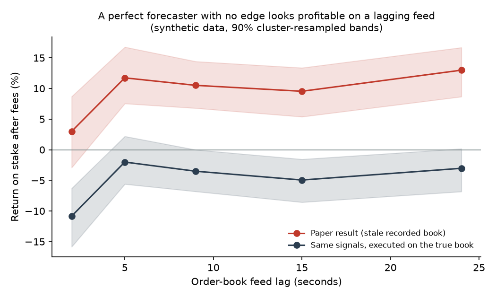

# kalshi-microstructure-study


Can one person with a small cloud server and no co-location make money trading Kalshi's short-horizon crypto
contracts after fees? I've been trying to answer that since October 2026. So far the answer is mostly no, and
this repo is the write-up of how I tested it and what I found.

The trading system itself stays private. What's here: the research questions, the methods, pre-registered test
protocols, results to date (including the failures), and clean reference implementations of the generic parts
with tests.

Status: ongoing. Two pre-registered forward tests finish on 2026-11-23.

## Short version

- Taking liquidity loses. Across about 25k replayed bets, the mispricings I could find (1 to 1.5 cents) were
  smaller than fee plus spread.
- Quoting passively gets picked off. My bids filled mostly when the price was moving through them. 22 rule
  variants ran in shadow mode on the live book and none beat the baseline.
- The market price is hard to beat as a forecast. On 141 settled contracts, a language model tied it (Brier
  0.1595 vs 0.1594) and my volatility model did worse (0.1730).
- I once had a strategy showing +15% on paper. It was fake: CPU throttling on the server had the order-book feed
  running about 9 seconds behind the exchange, so the "edge" was just stale prices. Re-priced correctly it was
  about 0%. Every health check said things were fine the whole time. That's the most useful thing I learned, and
  the demo below reproduces it.



The chart uses synthetic data. The forecaster here has no real edge, but once the recorded book lags by 5 to 24
seconds it shows a 10 to 13% paper return. The same signals filled at the real prices lose money.
Run `python examples/latency_artifact.py` to reproduce it.

## How I test ideas

Each idea goes through the same steps: historical replay, then paper trading, then a simulated account that fills
fake-money orders against the real live order book (only the size actually shown, after a realistic delay), then
a forward test whose rules, sample size and pass/fail threshold are written down before any of its data exists.
Real money only comes after a pass. Too few observations by the deadline counts as a fail.

More detail: [methodology](docs/methodology.md), [research questions](docs/research-questions.md),
[pre-registrations](docs/preregistration/).

## Results so far

| Question | Result |
|---|---|
| Taker bets, 15-minute contracts | Negative across ~25k replayed bets |
| Passive market making, 15-minute | Adversely selected; no variant reached significance |
| Forecasters vs. market (Brier) | Market about best; LLM tied it; volatility model worse |
| The +15% paper edge | Feed-lag artifact, about 0% once corrected |
| Earlier frozen test ("hunter" signals) | Failed: −2.88% over 1,020 bets |
| Hourly/daily ladder contracts | Pre-registered test running |
| Final-minute settlement average | Pre-registered test running |

Write-up: [findings](docs/findings-interim.md) · dated log: [lab notebook](docs/lab-notebook.md) ·
caveats: [limitations](docs/limitations-and-ethics.md)

## Code

```
src/kms/
  feed/        feed-lag tracking from exchange timestamps; a gate that blocks orders on stale data
  simulator/   binary order book (asks derived from the other side's bids), taker-fill simulation, fees
  strategies/  strategy interface and the pre-registered settlement-average model
  evaluation/  ROI and Brier with cluster-resampled intervals; pre-registered verdicts as code
examples/      latency_artifact.py, the synthetic demo above
tests/         pytest; CI also runs ruff and a short demo run
```

```bash
pip install -e ".[dev,examples]"
ruff check . && pytest -q
python examples/latency_artifact.py
```

```python
from kms.simulator import OrderBook, simulate_taker_fill
from kms.strategies import MarketSnapshot, SettlementAverageModel

book = OrderBook.from_bids(yes=[(0.78, 50)], no=[(0.20, 50)])   # YES ask = 0.80
model = SettlementAverageModel(sigma_per_s=0.005)
model.update_average(fixed_mean=100.4, n_fixed=30)               # 30 of the 60 settlement seconds are in
signal = model.signal(MarketSnapshot("DEMO", strike=100.0, seconds_to_close=30, spot=100.5, book=book))
fill = simulate_taker_fill(book, signal.side, limit=signal.ask + 0.01, contracts=10)
print(signal, fill.cost)
```

Not included: the full trading system, any exchange data, and any credentials. [src/README.md](src/README.md)
sketches the full architecture.

## Disclaimer

Research only, not financial advice. Event contracts can go to zero.

MIT for code, CC BY 4.0 for docs. Citation info in [CITATION.cff](CITATION.cff).
